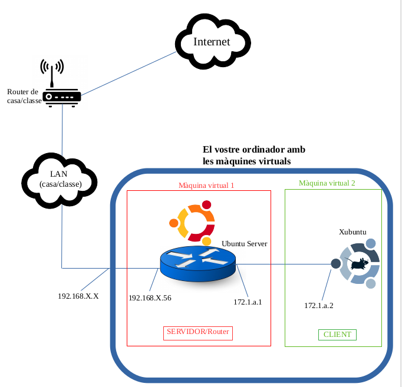

# Operació NordTec Yelyzaveta Sadova ASIX1B
# Índex
1. [Basic writing and formatting syntax](https://docs.github.com/en/get-started/writing-on-github/getting-started-with-writing-and-formatting-on-github/basic-writing-and-formatting-syntax?utm_source=chatgpt.com)
2. [My Note](https://hackmd.io/?nav=overview)
3. [Validate YAML Online.](https://yamlvalidator.dev/)
#### Estat del projecte

**_Fet_**

* S'ha creat el document del projecte.

* S'ha creat l'índex amb enllaços als diferents apartats.

**_Pendent_**

* Completar l'arquitectura de xarxa.

* Afegir les configuracions i explicar els fitxers de configuració.

* Documentar les incidències i les seves solucions.

* Explicar les decisions tècniques.

* Escriure les reflexions tècniques.
## Arquitectura de xarxa



####### Configuracions

En aquest apartat s'expliquen els fitxers de configuració utilitzats per gestionar el projecte amb Git.

### 1. Fitxer `.gitignore`

- **Funció:** Indica quins fitxers o directoris Git ha d'ignorar i no ha de tenir en compte per al seguiment de canvis.
- **Ús:** Permet evitar que s'afegeixin al repositori fitxers temporals o informació que no cal compartir.

### 2. Fitxer de configuració `.git/config`

- **Funció:** Emmagatzema la configuració específica del repositori local.
- **Ús:** Pot contenir informació sobre el repositori remot, com ara `origin`, i altres opcions de configuració.

### 3. Configuració de l'usuari

Git permet configurar el nom i el correu electrònic que apareixen als commits mitjançant les ordres:

```bash
git config --global user.name "Nom Cognom"
git config --global user.email "correu@example.com"
```

Aquesta configuració s'utilitza per identificar l'autor dels commits.

## Objectiu (Objective)
### Desplegar, protegir i monitorar la infraestructura d'una empresa mitjaçant tecnologies actuals d'administració de sistemes
---
## Estat de projecte
Iniciat
En construcció
---
## Arquitectura
Pendent dedissenyar
## Diari del projecte
### Dia 1
- Instal·lació deVisualStudio Code
- Instal·lació de Git
- Creació delrepositori del projecte
- Creació de l'estructura de carpetes
### Dia 2
### Dia 3
# Yelyzaveta
## Yelyzaveta 
## Yelyzaveta
**Yelyzaveta**
_Yelyzaveta_
## Les ordres bàsiques per pujar canvis a GitHub
1. git add .
2. git commit -m "message"
3. git push origin <route>
#### List :shipit::shipit::shipit::shipit::shipit::shipit::shipit::shipit::shipit::shipit::shipit::shipit::shipit::shipit::shipit::shipit::shipit::shipit::shipit::shipit::shipit::shipit::shipit:
1.La primera cosa
2.La segona cosa
3.La tercera cosa
[Useful Git commands](https://docs.github.com/en/get-started/writing-on-github/getting-started-with-writing-and-formatting-on-github/basic-writing-and-formatting-syntax?utm_source=chatgpt.com#lists).
| Command | What it does 
|------------|--------|
| git init    | Initializes a new Git repository in the current directory.  | 
| git status    | Shows the current state of your repository, including tracked and untracked files, modified files, and branch information.    | 
| git commit -m "<message>"      | Creates a new commit with the changes in the staging area and specifies the commit message inline.  | 
| git branch     | Lists all branches in the repository.    |
| git log     | Displays the commit history of the current branch.  |
| git pull     | Fetches changes from the remote repository and merges them into the current branch.    | 
# Incidencies

